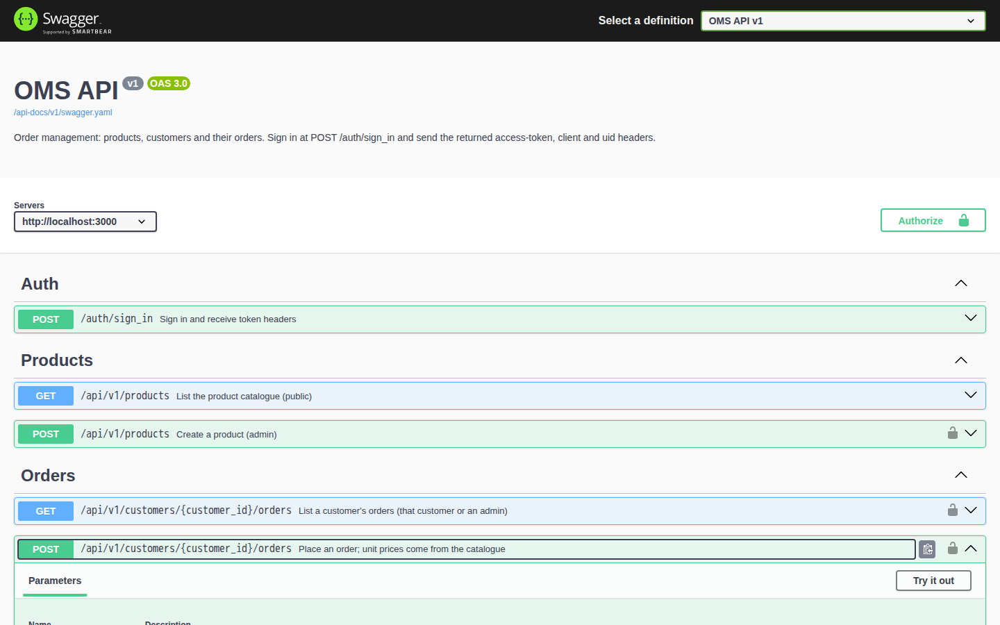
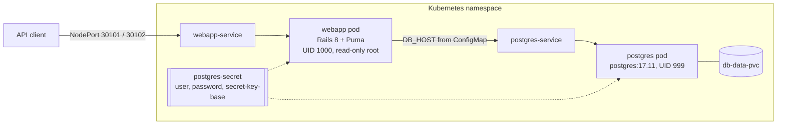

# OMS API on Kubernetes

A Rails 8 JSON API for order management (products, customers and their orders), packaged to run the same image three ways: Docker Compose on a laptop, raw Kubernetes manifests, or a Helm chart. A small Terraform module for an EC2 host is included as well.

The API side is deliberately ordinary Rails; the interesting part is how the pieces fit together: one non-root production image, credentials that never live in the repo, and manifests with probes, limits and a locked-down pod security context.



## What the API does

- **Products**: a public, paginated catalogue. Admins create, update and delete products. Each product gets a UPC from a database sequence that can't be changed afterwards, and a product that has been ordered can't be deleted.
- **Customers**: admins invite customers (an invitation email goes out); people can also sign up themselves. Customers can read and edit only their own record.
- **Orders**: an order belongs to a customer and has line items and a shipping address. Unit prices are copied from the catalogue when the order is placed, so a price sent by the client is ignored, and the total is the sum of quantity × price. Customers see and place only their own orders.
- **Auth**: token auth via `devise_token_auth`. `POST /auth/sign_in` returns `access-token`, `client` and `uid` headers, which you send back on later requests. Authorization rules live in `app/policies` (Pundit).

The OpenAPI document is generated from the request specs in `spec/requests/api` and served at `/api-docs`, both as Swagger UI and as `swagger/v1/swagger.yaml`.

## Repository layout

| Path | Contents |
| --- | --- |
| `app/` | Controllers (`api/v1`), models, Pundit policies, serializers, param validators |
| `Dockerfile`, `docker-entry.sh` | Multi-stage production image; the entrypoint runs `db:prepare`, then Puma |
| `docker-compose.yaml` | The production image plus PostgreSQL 17 for local use |
| `k8s/` | Plain manifests: Deployments, Services, ConfigMap, PV/PVC, a Secret template |
| `helm-chart/` | The same deployment as a Helm chart (`oms-api`) |
| `infrastructure/environments/dev` | Terraform: one EC2 instance plus a generated key pair |
| `spec/` | RSpec model, request and OpenAPI specs |

## Architecture



On startup the web container runs `bin/rails db:prepare`, which creates the database, loads `db/schema.rb` and seeds it the first time, and runs any pending migrations after that. The Kubernetes `startupProbe` allows up to three minutes for this before liveness checks begin.

## Run it with Docker Compose

Needs Docker with Compose v2.

```sh
cp .env.example .env
# Edit .env: set POSTGRES_PASSWORD, and SECRET_KEY_BASE to a long random string
# (for example the output of `openssl rand -hex 64`). Set SEED_ADMIN_PASSWORD
# if you want a demo admin to be created.
docker compose up --build
```

The API listens on <http://localhost:3000> and Swagger UI on <http://localhost:3000/api-docs>. If something else on your machine already uses port 3000, change the left side of `"3000:3000"` in `docker-compose.yaml`.

The web container runs with a read-only root filesystem and writable tmpfs mounts only for `/app/tmp` and `/tmp`, the same as in the Kubernetes manifests. Outgoing mail uses the `test` delivery method, so invitation emails are built but never sent.

Stop the stack with `docker compose down`, or with `docker compose down -v` to delete the database volume too.

## Using the API

The examples below come from a fresh Compose stack with the demo seed data. Tokens are shortened.

List the catalogue (no auth needed; `page` and `per_page` are optional, and `per_page` is capped at 100):

```sh
curl 'localhost:3000/api/v1/products?per_page=2'
```

```json
{"products":[{"id":1,"description":"1.7 l, auto shut-off","price":"39.9","title":"Stainless kettle","upc":1,"weight":"1.2","weight_unit":"kg"},
             {"id":2,"description":"350 ml, dishwasher safe","price":"6.5","title":"Ceramic mug","upc":2,"weight":"320.0","weight_unit":"g"}],
 "meta":{"page":1,"per_page":2,"total_count":3,"total_pages":2}}
```

Sign in as the seeded admin. The tokens come back as response headers:

```sh
curl -i -H 'Content-Type: application/json' \
  -d '{"email":"admin@example.com","password":"<SEED_ADMIN_PASSWORD>"}' \
  localhost:3000/auth/sign_in
```

```
access-token: pvlbi4...(redacted)
client: xju_Vd...(redacted)
uid: admin@example.com
token-type: Bearer

{"data":{"email":"admin@example.com","provider":"email","uid":"admin@example.com","id":1,"name":"Demo Admin","phone":"+1-555-0100","type":"Admin", ...}}
```

Invite a customer, then place an order for them. The second line item's `product_price` is ignored, and the server uses the catalogue price:

```sh
AUTH=(-H "access-token: $TOKEN" -H "client: $CLIENT" -H "uid: admin@example.com" -H 'Content-Type: application/json')

curl "${AUTH[@]}" -d '{"customer":{"name":"Grace Hopper","email":"grace@example.com","phone":"+1-555-0142"}}' \
  localhost:3000/api/v1/customers
# {"id":2,"email":"grace@example.com","name":"Grace Hopper","phone":"+1-555-0142","uid":"grace@example.com"}

curl "${AUTH[@]}" localhost:3000/api/v1/customers/2/orders -d '{"order":{
  "number":7001,"date":"2026-11-10","payment_type":"credit_card",
  "line_items_attributes":[{"product_id":1,"product_quantity":2},
                           {"product_id":2,"product_quantity":4,"product_price":0.01}],
  "shipping_address_attributes":{"address_line":"1 Main St","city":"Springfield",
                                 "state":"IL","zip_code":"62701","country_code":"US"}}}'
```

```json
{"id":1,"date":"2026-11-10","payment_type":"credit_card","total_value":"105.8",
 "customer":{"id":2,"email":"grace@example.com","name":"Grace Hopper", ...},
 "shipping_address":{"id":1,"address_line":"1 Main St","city":"Springfield", ...},
 "line_items":[{"id":1,"product_quantity":2,"product_price":"39.9","product":{"id":1,"title":"Stainless kettle", ...}},
               {"id":2,"product_quantity":4,"product_price":"6.5","product":{"id":2,"title":"Ceramic mug", ...}}]}
```

Errors are JSON with a `message` key. Requests without a token get `401`. Signed-in users who aren't allowed to do something get `403`, and validation failures get `422`.

| Method | Path | Who |
| --- | --- | --- |
| `POST` | `/auth` | anyone (creates a Customer) |
| `POST` | `/auth/sign_in`, `DELETE /auth/sign_out` | anyone / signed in |
| `GET` | `/api/v1/products` | anyone |
| `POST`, `PUT`, `DELETE` | `/api/v1/products[/:id]` | admin |
| `GET`, `POST` | `/api/v1/customers` | admin |
| `GET`, `PATCH`, `DELETE` | `/api/v1/customers/:id` | admin or that customer |
| `GET`, `POST` | `/api/v1/customers/:customer_id/orders` | admin or that customer |
| `GET`, `DELETE` | `/api/v1/customers/:customer_id/orders/:id` | admin or that customer |
| `GET` | `/up` | health check for probes |

## Deploying to Kubernetes

Both options expect the image to be available to the cluster as `oms-api:1.0.0`. Build it with `docker build -t oms-api:1.0.0 .`, then load it into kind or minikube, or push it to your own registry and change the image reference.

### With Helm

The chart has no credentials in it. You pass them in at install time:

```sh
helm install oms ./helm-chart \
  --set auth.postgresPassword="$(openssl rand -hex 16)" \
  --set auth.secretKeyBase="$(openssl rand -hex 64)"
```

Or point it at a Secret you manage yourself. The Secret needs the keys `postgres-user`, `postgres-password` and `secret-key-base`:

```sh
helm install oms ./helm-chart --set auth.existingSecret=my-oms-secret
```

Rendering fails with a clear message if you set neither. Other useful values are `webapp.image.repository`/`tag`, `webapp.imagePullSecrets`, `webapp.replicas`, `*.resources`, and `persistentVolume.create=false` to use a StorageClass instead of the bundled hostPath volume.

### With plain manifests

```sh
cp k8s/secret/postgres-secret.example.yaml k8s/secret/postgres-secret.yaml   # gitignored
# replace the CHANGE_ME values, then:
kubectl apply -f k8s/secret/postgres-secret.yaml
kubectl apply -f k8s/configmap -f k8s/volumes -f k8s/services -f k8s/deployments
```

The web service is a NodePort: 30101 for the plain manifests, 30102 for the chart.

### What the manifests enforce

- Both pods run as non-root (`runAsNonRoot`, fixed UIDs) with `seccompProfile: RuntimeDefault`, all capabilities dropped and privilege escalation disabled. The web container's root filesystem is read-only.
- CPU and memory requests and limits on every container.
- Readiness and liveness probes: `pg_isready` for Postgres, and `GET /up` for Rails, plus a startup probe.
- Pinned image tags. The Postgres data volume is mounted into the Postgres pod, which uses the `Recreate` strategy because the claim is ReadWriteOnce.
- `automountServiceAccountToken: false`, because neither pod talks to the Kubernetes API.

## Terraform

`infrastructure/environments/dev` creates a single `t2.micro` EC2 instance in `us-east-1` with an RSA key pair. The private key is written locally as a gitignored `*.pem` file. It doesn't install Kubernetes or the app, so treat it as a starting point for a dev host.

```sh
cd infrastructure/environments/dev
terraform init && terraform plan -var-file=vars.tfvars
```

## Development and tests

The project pins Ruby 3.4.12 (`.ruby-version`) and runs on Rails 8.0. The specs need PostgreSQL. Here is one way to run them without installing anything locally:

```sh
docker network create oms-test
docker run -d --rm --name oms-test-db --network oms-test -e POSTGRES_PASSWORD=postgres postgres:17.11
docker run --rm --network oms-test -e DB_HOST=oms-test-db -e RAILS_ENV=test \
  -v "$PWD":/app -w /app ruby:3.4.12 \
  sh -c 'bundle install && bin/rails db:create db:schema:load && bundle exec rspec && bundle exec rubocop'
docker stop oms-test-db && docker network rm oms-test
```

With a local Ruby and Postgres, `bundle install`, `bin/rails db:prepare`, `bundle exec rspec` and `bin/rails server` work as usual. Development mode sends mail to `letter_opener_web` at `/letter_opener`.

The suite covers models, policies through request specs, pagination and the seeds. Bullet runs with `raise = true` in the test environment, so a request spec fails if it triggers an N+1 query. To regenerate the OpenAPI file after changing `spec/requests/api`, run:

```sh
RAILS_ENV=test bundle exec rails rswag:specs:swaggerize
```

## Design notes

- **One image everywhere.** Compose, the plain manifests and the chart all run the production image with the same environment variables (`DB_HOST`, `POSTGRES_*`, `SECRET_KEY_BASE`). `config/database.yml` has no production fallbacks, so a missing password stops the app at boot. Nothing guesses a value.
- **Policies, not controller conditionals.** `Api::V1::Auth::BaseController` authenticates first, then authorizes collection actions against the model and member actions against the loaded record. Orders override that target so a listing is checked against the customer in the URL.
- **Prices are server-side.** A line item copies its unit price from the product when it is created. The order total is computed before save, so it needs no second `UPDATE`.
- **Index endpoints paginate.** `BaseCollection` applies `page`/`per_page` in a stable id order and returns `meta` with the totals. An empty page is a `200`.

## Limitations

- PostgreSQL runs as a single pod with a hostPath volume by default. That suits a local cluster but not production; use a managed database or an operator there.
- `db:prepare` runs in every web pod's entrypoint. With several replicas, set `RUN_DB_PREPARE=false` and run migrations as a separate Job.
- There is no Ingress or TLS. Put the service behind your ingress controller, and set `FORCE_SSL=true` if the app is reached over HTTPS directly.
- Mail jobs use Rails' in-process async queue, so a pod restart can drop an unsent invitation email.
- On a database built from `db/schema.rb`, UPCs start at 1. The original migration started them at 1000.

## License

MIT, see [LICENSE](LICENSE).
